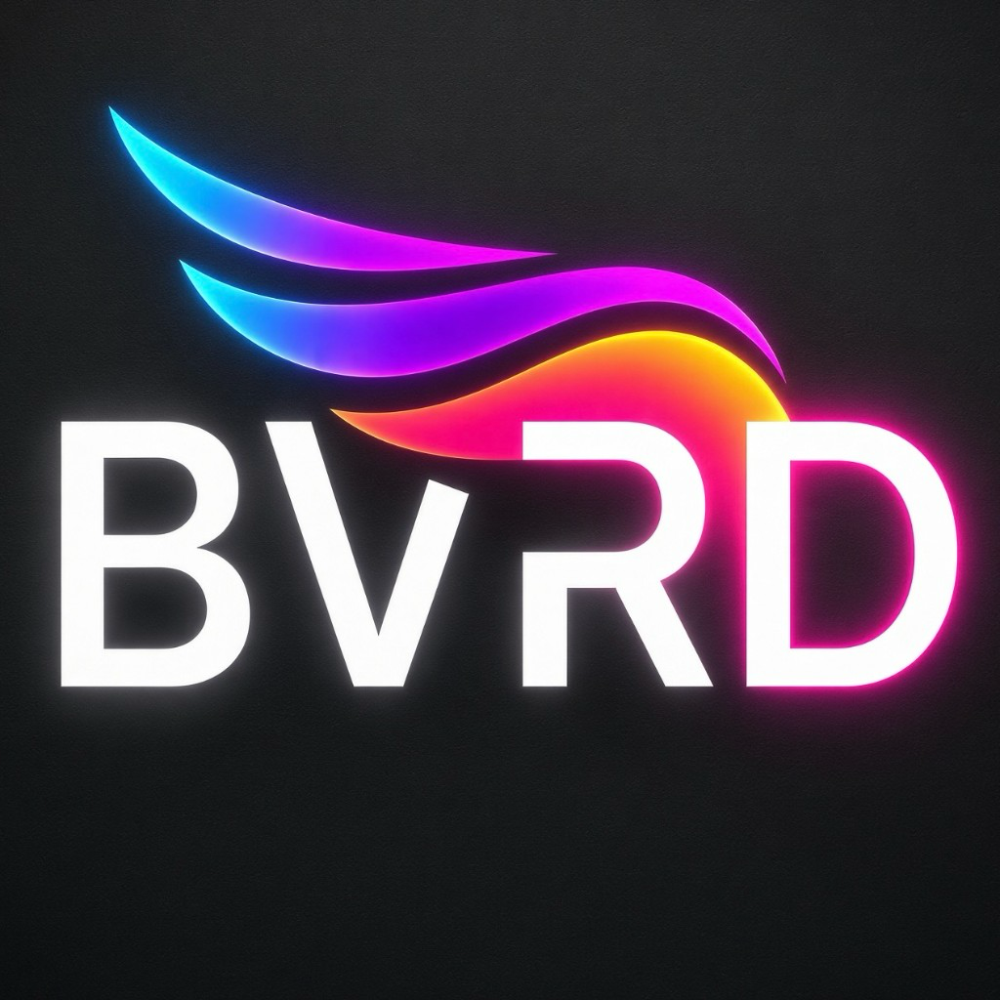

# BVRD

<p align="center">
  
</p>

A Mac app that reads text out loud. Highlight text in any app and press **⌃⌥S** (default). After the first setup it works offline, and you don't need an account.

The voices come from Chatterbox Turbo. You can clone a voice from a short recording (aim for at least 6 seconds). Ten starter voices are included, from public-domain LibriVox recordings. Speed can change without the pitch going up or down. Tags like `[laugh]` and `[sigh]` work. It lives in the menu bar and unloads the voice model when it's been idle.

## What you need

- A Mac with Apple Silicon (M1 or later) and macOS 14 or later
- About 4.5 GB free. Most of that is the voice model, about 3.5 GB, which the app downloads the first time you open it.

## Install

The release has the app by itself: [BVRD-1.0.0.dmg](https://github.com/tommyawallace/bvrd/releases/download/v1.0.0/BVRD-1.0.0.dmg). The source code on that page is only if you want to build it.

1. Open the disk image and drag BVRD to Applications.
2. Open it. If macOS says it can't check the app, click **Done**, then System Settings > Privacy & Security > **Open Anyway**. You only have to do that once.
3. On the welcome screen, click **Download** and wait for the voice model.
4. When it asks, turn on Accessibility for BVRD. That's how the shortcut can read the text you highlighted.

## Building it

You need Xcode (or the command line tools) and uv (`brew install uv`).

```bash
app/build_app.sh
app/make_dmg.sh
```

The first command builds the app, puts it in /Applications, and opens it. The second one makes the disk image at `dist/BVRD-<version>.dmg`.

## License

BVRD's own code is [MIT](LICENSE).

The app also includes other people's code, and that stays under its own licenses: MIT, BSD, Apache 2.0, and LGPL. See [`THIRD_PARTY_NOTICES.md`](THIRD_PARTY_NOTICES.md). Help > Acknowledgements in the app shows the full text.

---

*© 2026 Tommy Wallace. MIT License.*